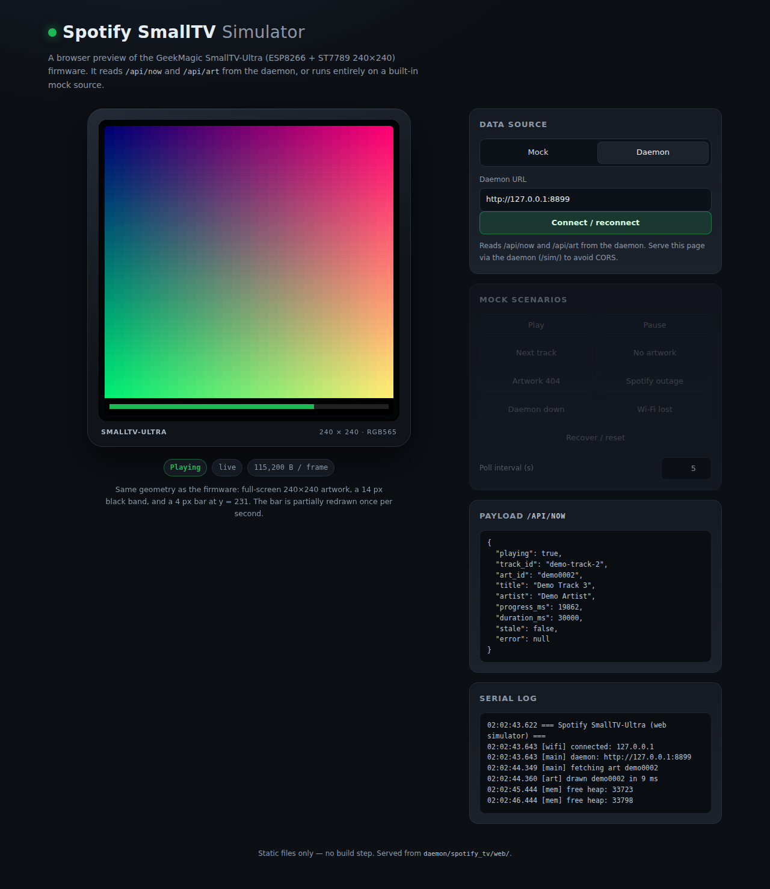

# Spotify SmallTV Simulator

[](LICENSE)

GeekMagic SmallTV-Ultra（ESP8266 + ST7789 240×240）用ファームウェア
[okibaaa/spotify-smalltv](https://github.com/okibaaa/spotify-smalltv) の表示と状態遷移を、
ブラウザで再現するシミュレーターです。

**オンライン版:** <https://okibaaa.github.io/spotify-smalltv-simulator/>



## できること

- 実機と同じ座標で描画（ジャケット 240×240 / 下部 14px の黒帯 / y=231・高さ 4px のバー）
- デーモンの `/api/now` と `/api/art` を読み、**RGB565 リトルエンディアンのバイナリを実際にデコード**して表示
- ファームウェアの状態遷移を再現: `Boot / WifiError / ConnError / SpotifyError / ArtError / Idle / Playing`
- 5 秒ポーリング、1 秒ごとのバー部分再描画、曲終端での即時ポーリング、アート再試行まで同じ挙動
- シリアルログ風のログ（`[main] fetching art ...` / `[art] drawn ... in N ms` / `[mem] free heap: ...`）
- 受信 JSON（`/api/now` 相当）の表示

## 使い方

### 1. モックモード（Spotify もデーモンも不要）

ページを開くだけです。canvas でジャケットを生成し、RGB565 にエンコード → デコードする経路も通します。

| ボタン | 期待される表示 |
|---|---|
| Play / Pause | `Playing` ⇄ `Idle` |
| Next track | ジャケット差し替え |
| No artwork | プレースホルダ（Spotify グリーン） |
| Artwork 404 | `Artwork error`（次回ポーリングで再試行） |
| Spotify outage | `Spotify error`（`stale: true`） |
| Daemon down | `Connection error` |
| Wi-Fi lost | `Wi-Fi error` |
| Recover / reset | 全フラグを解除して `Playing` に戻す |

`file://` で直接開いても動きます。

### 2. ライブモード（実データを表示）

`spotify-smalltv` のデーモンを起動し、このリポジトリをローカルの HTTP サーバーで配信します。

```bash
# 1) デーモン（デモモードで OK）
cd spotify-smalltv
make demo            # http://localhost:8888

# 2) シミュレーター
cd spotify-smalltv-simulator
make serve           # http://localhost:8000/  (PORT=8080 make serve でも可)
```

「Daemon」タブを選び、Daemon URL に `http://localhost:8888` を入れて **Connect**。

デーモン側で CORS を許可している必要があります（`spotify-smalltv` の現行版は `/api/*` への
クロスオリジン GET を許可済み）。古いバージョンを使っている場合はデーモンを更新してください。

> **GitHub Pages 版について**
> 公開版は `https` なので、`http://localhost` へのアクセスがブラウザにブロックされる場合があります
> （Chrome / Firefox は localhost を例外扱いしますが、Safari などは拒否します）。
> ライブ表示はローカルで `make serve` して開くのが確実です。

## 実装

依存なし・ビルド不要の静的ファイルだけです。

| ファイル | 内容 |
|---|---|
| `index.html` | レイアウトと操作パネル |
| `style.css` | ダークテーマ、実機風ベゼル、レスポンシブ |
| `app.js` | RGB565 のエンコード / デコード、描画、ファームウェアの状態機械、モック / デーモンのデータソース |
| `Makefile` | `make serve`（`python3 -m http.server` のショートカット） |

`app.js` の `Screen` と `Firmware` は、それぞれ `firmware/src/display.cpp` と
`firmware/src/main.cpp` の対応する処理を写したものです。ファーム側を変更したときは、
ここも合わせて更新してください。

デバッグ用に `window.SmallTV` として内部 API（`Firmware` / `MockSource` /
`encodeRgb565Le` など）を公開しています。

## ライセンス

[MIT](LICENSE) — 元リポジトリ [okibaaa/spotify-smalltv](https://github.com/okibaaa/spotify-smalltv) と同じです。
